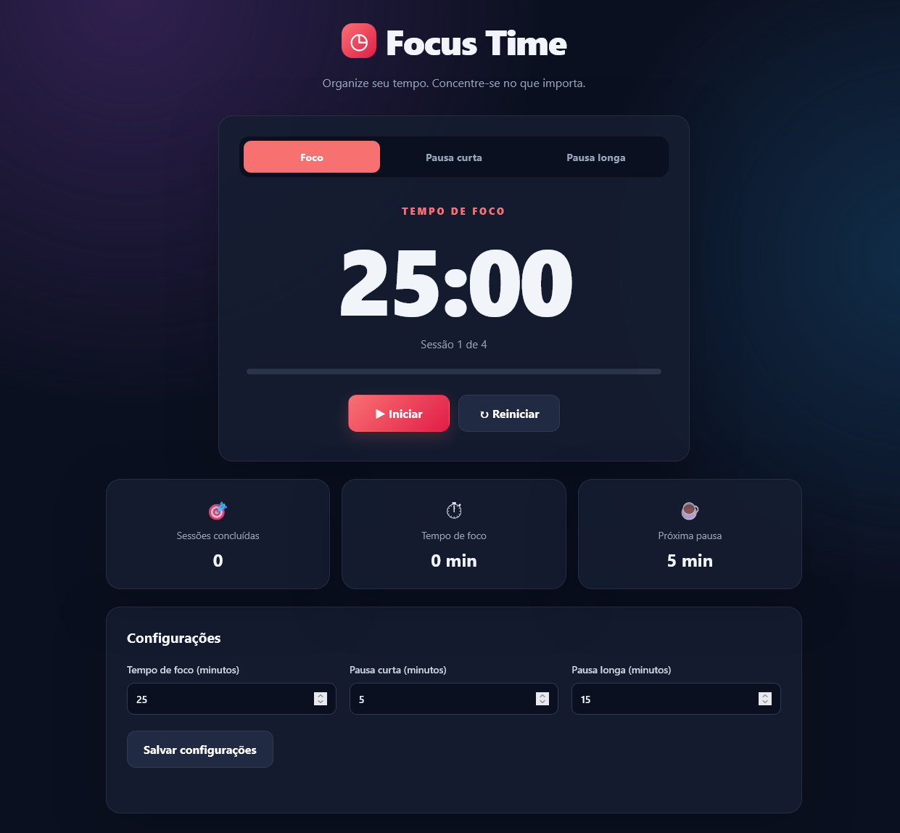

# Pomodoro Clock

A productivity timer built with HTML, CSS, and JavaScript, inspired by the Pomodoro Technique. It helps users manage study sessions, take regular breaks, and improve focus.

## Features

- **Focus Timer:** Default 25-minute work sessions.
- **Short Break:** Default 5-minute breaks between focus sessions.
- **Long Break:** Default 15-minute breaks after four completed focus sessions.
- **Timer Controls:** Start, pause, and reset the current session.
- **Custom Settings:** Configure focus and break durations.
- **Progress Bar:** Track the progress of the current session.
- **Session Counter:** Count completed focus sessions.
- **Focus Statistics:** Track the total minutes of completed focus sessions.
- **Sound Alert:** Play a notification when a session ends.
- **Responsive Design:** Adapt to desktop, tablet, and mobile screens.

## Technologies

- HTML5
- CSS3
- JavaScript (Vanilla JS)
- Web Audio API

## Project Structure

```text
Pomodoro-Clock/
├── index.html
├── css/
│   └── styles.css
├── js/
│   └── script.js
├── assets/
│   └── sounds/
└── README.md
```

## Getting Started

### 1. Clone the repository

```bash
git clone https://github.com/Taunt-byte/Pomodoro-Clock.git
```

### 2. Navigate to the project directory

```bash
cd Pomodoro-Clock
```

### 3. Run the application

Open `index.html` in your browser.

You can also use the Live Server extension in Visual Studio Code for a convenient development workflow.

## How to Use

1. Select **Focus**, **Short Break**, or **Long Break**.
2. Click **Start** to begin the countdown.
3. Click **Pause** to temporarily stop the timer.
4. Click **Reset** to restore the current session's duration.
5. Customize the timer durations in the settings section.
6. Click **Save Settings** to apply your changes.
7. Complete four focus sessions to reach the recommended long-break interval.

## The Pomodoro Technique

The Pomodoro Technique is a time-management method that alternates focused work periods with short breaks.

A typical cycle consists of:

1. Work for 25 minutes.
2. Take a 5-minute break.
3. Repeat the cycle four times.
4. Take a longer break of 15 minutes.

The durations can be customized in this application.

## Learning Objectives

This project provides practice with:

- DOM manipulation and event listeners.
- JavaScript timers and time calculations.
- Managing application state.
- Functions and conditional logic.
- CSS Grid, Flexbox, and responsive layouts.
- Form validation and user input.
- The Web Audio API.
- Updating progress indicators dynamically.

## Future Improvements

- Save settings and statistics using `localStorage`.
- Add daily productivity summaries.
- Display desktop notifications.
- Add keyboard shortcuts.
- Include an optional automatic session transition.
- Add a task list for organizing study activities.
- Add a dark/light theme selector.

## Screenshot


